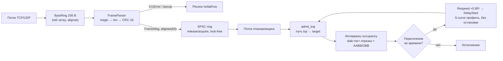

# ТАКТ — детерминированное ядро реального времени: zero-allocation планировщик и парсер бинарного протокола (C++20)

> **Серия «Матчасть»** — ответ на «Матчасти нет / это программно невозможно».
> Две половины доказательства: **ТАКТ** — системное ядро (эта задача),
> **[ИГНИЦИЯ](https://github.com/Bezooom/ignition-solver)** — численное ядро
> (жёсткая МФЕ, закон сохранения на уровне round-off). Оба написаны с нуля
> локальной моделью; каждый — с матрицей приёмки и честными ограничениями.

**Написан с нуля полностью локально, без облачных API: кодинг-агент с моделью
Strata (квантованный Qwen, IQ3) на не самом дорогом железе — Xeon E5-2699 v3,
64 GB RAM, RTX 3090 24 GB.**


Детерминированный планировщик реального времени и парсер бинарного
промышленного протокола на **C++20** без динамических аллокаций:
**zero-allocation** после инициализации, **lock-free SPSC** с корректными
барьерами памяти, **CRC-16-CCITT** c побайтовым ресинком, jerk-limited S-curve
траектории, разрешение конфликтов зон без остановки цикла. Как это работало:
[docs/LOCAL-MODEL.md](docs/LOCAL-MODEL.md).

---

## Результаты (полный лог — в [docs/VERIFICATION.md](docs/VERIFICATION.md))

| Критерий | Доказательство | Вердикт |
|---|---|---|
| Сборка без предупреждений | `-Wall -Wextra -Wpedantic -Wshadow -Werror`, g++ 13.3 | PASS |
| CRC-16-CCITT-FALSE | эталон `«123456789» → 0x29B1` в `static_assert` + сверка с `binascii.crc_hqx` | PASS |
| Битый кадр не попадает в планировщик | стресс 100k: `crc=50000` отброшено, `planned+rejected = ok = 50000` | PASS |
| Ноль аллокаций в горячем пути | подменённый глобальный `operator new` → `bad_alloc`; 100k кадров, ни одного срабатывания | PASS |
| Конфликт траекторий в зоне | AABB и OBB: интервалы occupancy разъехались, робот с высшим приоритетом побайтно нетронут, оба доехали до цели | PASS |
| Цикл не останавливается | скорость victim в середине окна зоны > 0.1 м/с после `Respeed` | PASS |
| Отсутствие гонок и дедлоков | TSan: стресс 20k кадров, 2 потока, exit 0 | PASS |

Все строки таблицы даёт один `make run`: **~10 секунд с компиляцией**,
сами прогоны — доли секунды. Это время вычислений, а не написания кода —
разработка и отладка шли отдельным рабочим циклом; облака при этом не было
ни на одном шаге.

## Мотивация

Типовой спор двух миров: «разработчики не шарят за производство» и «локальная
модель не напишет низкий уровень». Демонстрируется пересечение — реальный
класс задач цеха:

- закрытый контур ГПЯ: 3 робота-манипулятора с общими зонами досягаемости, 2 станка ЧПУ;
- облачные API физически недоступны → весь цикл (код, сборка, верификация) локальный;
- требования промышленного уровня: детерминизм, отсутствие аллокаций в горячем
  пути, корректные барьеры памяти, валидация каждого байта линии связи.

## Быстрый старт

Требуется GCC ≥ 13 (полный C++20). Других зависимостей нет.

```bash
git clone https://github.com/Bezooom/takt-rt.git
cd takt-rt
make run        # test_plain + ASan/UBSan + TSan, один проход
```

Ожидаемый финал каждой сборки: `=== RESULT: PASS (0 failures) ===`.
Сборки: `test_plain` (100 000 кадров, детектор аллокаций включён),
`test_asan` (ASan+UBSan), `test_tsan` (TSan; на ядрах 6.8+ с новым раскладом
виртуальной памяти запуск через `setarch $(uname -m) -R` — уже в `make run`).

## Задача

Поток байтов из цеха → валидные команды движения → бесконфликтные траектории
трёх роботов и двух станков за полиморфный бюджет кадра.

Протокол в двух строках — big-endian, заголовок 18 байт, максимум 84:

```text
magic(2) ver(1) type(1) len(2) seq(2) ts_ms(4) axis_mask(4) axes(2)
  | coords axes×4 (Q16.16) | crc16(2)
```

Тестовый вектор (команда TRAJ_CMD, seq=0x1234, цель (10, 3, 0)) и полная
таблица полей: [docs/PROTOCOL.md](docs/PROTOCOL.md).

## Архитектура



Ключевые инварианты:

1. После инициализации — ноль `new`/`malloc`; все структуры статические
   (`std::array`, `alignas(64)`), парсер работает через `std::span` побайтно
   (нет UB strict-aliasing).
2. Планировщик однопоточный; единственный канал «сеть → цех» — SPSC-очередь
   с монотонными `uint64`-индексами и `memory_order_release/acquire`.
3. Разрешение коллизий детерминировано: фиксированный порядок обхода пар,
   максимум 8 проходов, максимум 6 попыток `Respeed`.

## Как это работает (выжимка)

1. **Парсер.** Конвейер magic→len→CRC с побайтовым ресинком: битый кадр
   физически не может попасть в планировщик — учёт `crc + ok = N` сходится.
2. **Переход через границу потока.** SPSC без CAS: монотонные индексы и
   release/acquire дают lock-free корректность; ложный sharing — padding’ом
   до 64 байт.
3. **Конфликт — не катастрофа, а арифметика.** Пересечение occupancy-интервалов
   решается замедлением жертвы по jerk-limited S-curve (или сдвигом старта):
   робот с высшим приоритетом не меняется побайтно, цикл не останавливается.

## Производительность

Xeon E5-2699 v3, `-O2`: полный прогон тестового цикла (парсинг + CRC + SPSC +
планировщик, 100k кадров в 2 потока) — **≈ 40 мс**, то есть
**≈ 2.5 млн кадров/с** на одном ядре 2015 года. Для шины цеха на сотни кадров
в секунду запас — три порядка.

## Документация

| Документ | Содержание |
|---|---|
| [docs/PROTOCOL.md](docs/PROTOCOL.md) | формат кадра, CRC-параметры, Q16.16, автомат парсера, тест-векторы |
| [docs/TRAJECTORY.md](docs/TRAJECTORY.md) | 7-сегментный jerk-limited профиль: три аналитические ветки, доказательства инвариантов |
| [docs/SCHEDULING.md](docs/SCHEDULING.md) | Job-Shop, интервалы occupancy, Respeed/DelayStart, детерминизм |
| [docs/CONCURRENCY.md](docs/CONCURRENCY.md) | lock-free SPSC: барьеры памяти, почему без CAS, padding |
| [docs/VERIFICATION.md](docs/VERIFICATION.md) | команды, вывод санитайзеров, матрица приёмки, кейсы дефектов |
| [docs/LOCAL-MODEL.md](docs/LOCAL-MODEL.md) | как это написано локальной моделью: стенд, цикл генерация→верификация, уроки |

## Структура

```text
takt-rt/
├── Makefile
├── include/rt/
│   ├── protocol.hpp    # кадр, CRC-16 (constexpr-таблица), ByteRing, FrameParser, FrameWriter
│   ├── spsc.hpp        # lock-free SPSC ring buffer
│   ├── geometry.hpp    # Vec3, AABB, OBB, slab-пересечение отрезка с боксом
│   ├── traj.hpp        # S-curve jerk-limited профиль + инверсия времени
│   └── scheduler.hpp   # роботы, зоны, станки, occupancy, mitigation, Job-Shop
└── tests/main.cpp      # 6 модульных тестов + стресс + zero-alloc guard
```

## Честные ограничения

- Робот — материальная точка TCP по полилинии; кинематика манипулятора
  (ориентация инструмента, самостолкновение) вне объёма.
- Планировщик однопоточный и итеративный (≤ 8 проходов): достаточно для трёх
  роботов, не доказан для произвольных конфигураций.
- `DelayStart` — фазовый сдвиг, а не перестройка всего расписания.
- Станки учтены как Job-Shop ресурс «занят до времени T», без оснастки/инструмента.

## Воспроизводимость

- g++ 13.3.0 (Ubuntu 24.04), Linux 7.0 x86_64; на новых ядрах TSan требует
  `setarch -R` (обход поломки рантайма TSan, не кода).
- Железо разработки и прогонов: Intel Xeon E5-2699 v3 (36 нит.), 64 GB RAM,
  2×RTX 3090 24 GB (GPU для кода не используется — stdlib C++20).
- Полный лог и матрица приёмки: [docs/VERIFICATION.md](docs/VERIFICATION.md).

## Происхождение

Проект выполнен в октябре 2026 г. полностью на локальном контуре. Модель не
«угадала правильную версию с первого раза»: четыре скрытых дефекта (знак в
OBB slab, вырожденная ветка S-curve, несуществующий id, молчаливый дефолт)
нашли санитайзеры, Python-оракул и бухгалтерия событий — модель чинила их
как инженер с тестами. Подробно: [docs/LOCAL-MODEL.md](docs/LOCAL-MODEL.md).

## References

- ISO/IEC 14882:2020 (*C++20*) — `std::span`, `std::atomic` memory orderings.
- Preshing, J. *Memory Ordering in C++, Part 1* — практика release/acquire.
- Rock, G. *CRC RevEng catalogue* — параметры CRC-16/CCITT-FALSE.
- Pinedo, M. *Scheduling: Theory, Algorithms, and Systems* — Job-Shop.

## Лицензия

MIT — см. [LICENSE](LICENSE).
